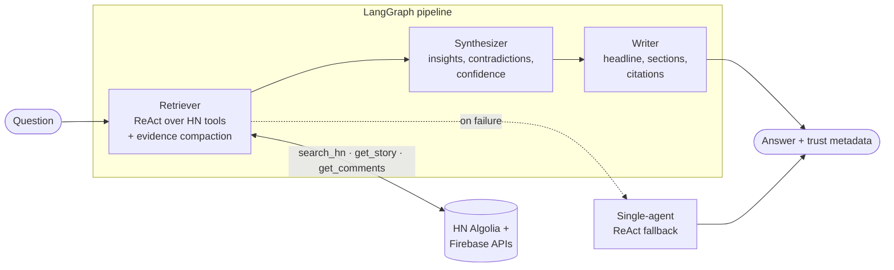
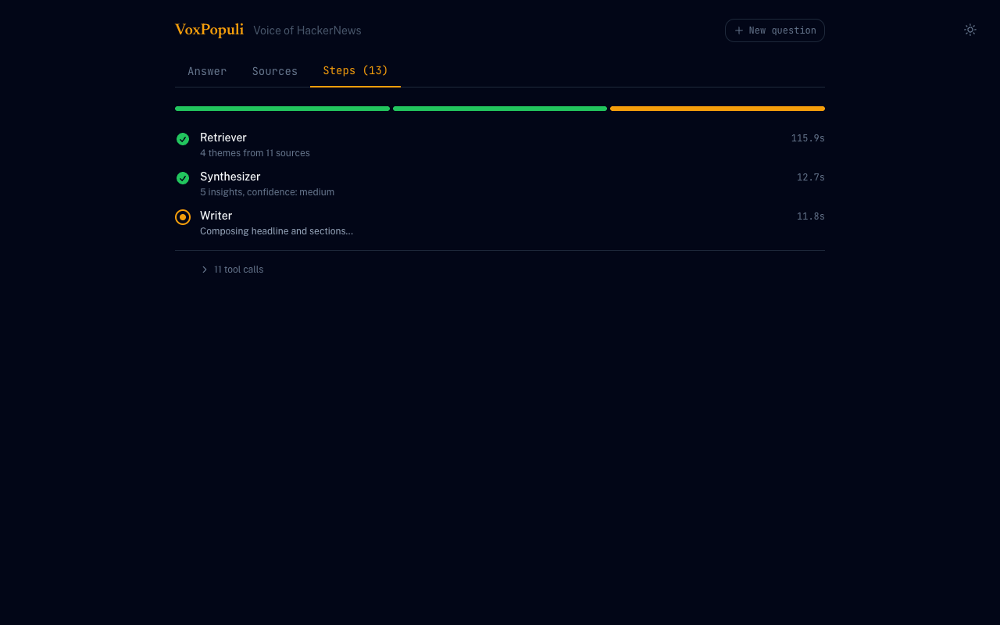
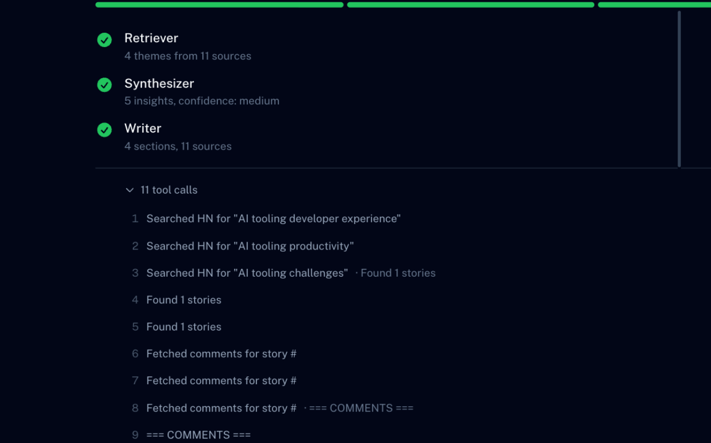
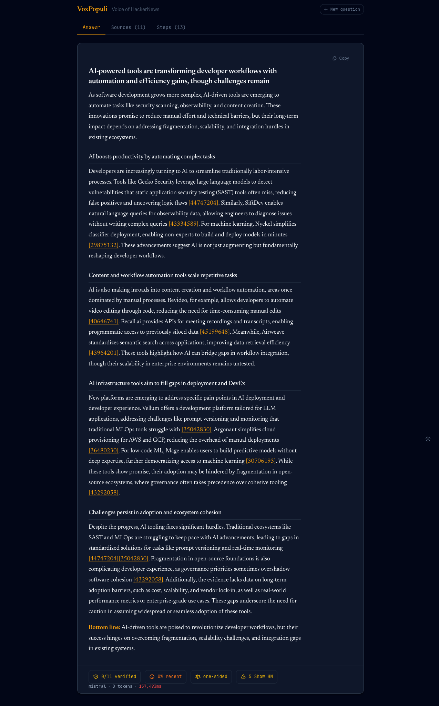

# VoxPopuli

[](https://github.com/darth-dodo/voxpopuli/actions/workflows/ci.yml)
[](https://codecov.io/gh/darth-dodo/voxpopuli)
[](LICENSE)
[](https://nodejs.org)
[](https://nestjs.com)
[](https://angular.dev)
[](https://langchain-ai.github.io/langgraphjs/)
[](https://voxpopuli-web-embx.onrender.com/)

Hacker News holds eighteen years of technical discussion from engineers, founders and researchers, but the useful part is usually three levels deep in a 400 comment thread, and Algolia search only matches keywords. I built VoxPopuli so I could ask a question in plain English and get back what HN actually thinks, with every claim linked to the thread it came from and an honest note about how strong the evidence is.

You type a question and watch three agents work through it live: one searches HN and reads the comment threads, one weighs the evidence and the disagreements, and one writes a short editorial answer with citations. If you would rather listen, one click turns the answer into a narrated clip.

<p align="center">
  <a href="https://voxpopuli-web-embx.onrender.com/"><strong>Try the live demo</strong></a>
</p>

<p align="center">
  
</p>

## Contents

- [What it does](#what-it-does)
- [How a question gets answered](#how-a-question-gets-answered)
- [Decisions that shaped it](#decisions-that-shaped-it)
- [Run it locally](#run-it-locally)
- [Configuration](#configuration)
- [API](#api)
- [Tests and evals](#tests-and-evals)
- [Deployment](#deployment)
- [Documentation](#documentation)
- [Contributing](#contributing)

## What it does

Every answer is grounded in real HN stories and comments, and each claim links back to its source thread. Alongside the answer, a trust bar reports how many sources were verified, how recent they are and whether the discussion is balanced, one sided or contested. When fewer than three sources turn up, the stated confidence is capped and the answer says what it could not find, because a confident answer built on one thread would be worse than an honest gap.

The answer streams in as a draft while the Writer is still composing it, so you are reading within seconds instead of waiting for the final cited version that replaces it. A follow-up question under an answer reuses that answer's evidence for 30 minutes instead of searching HN again, and asking the same question within 15 minutes replays the finished answer instantly.

Listen mode rewrites the answer as a short spoken script and voices it with Mistral Voxtral, with playback speed controls and an MP3 download. You can switch the model per question between Mistral, Claude and Qwen3 through OpenRouter, and the app works in light and dark themes from a phone up to a desktop. A run in progress survives a locked phone or a background tab, because results are stored on the server by query ID instead of living in the browser's connection.

## How a question gets answered

```
You:   "Is SQLite good enough for production web apps?"

VoxPopuli:
  [Retriever]   Searching "SQLite production"        5 stories
  [Retriever]   Searching "SQLite scaling"           3 stories
  [Retriever]   Reading comments #39482731           28 comments
  [Synthesizer] Extracting insights and contradictions
  [Writer]      Composing editorial answer

  "HN is broadly positive, with caveats around write-heavy workloads.
   Projects like Litestream and Turso were frequently cited..."

  4/4 sources verified · mostly recent · multiple viewpoints
```



The **Retriever** is a ReAct agent with three tools: `search_hn` over Algolia, and `get_story` and `get_comments` over the HN Firebase API. It splits comparison and time-based questions into several searches, reads the most relevant comment trees (capped at 30 comments per story) and compacts what it found into a structured evidence bundle of themes. The **Synthesizer** reads that bundle and pulls out insights, contradictions, a confidence level and the gaps in the evidence. The **Writer** turns the analysis into the answer you read, with a headline, short sections, citations and a bottom line.

Trust metadata is computed afterwards by a plain function that checks source verification, recency, viewpoint diversity and Show HN bias, so it gives the same result whichever path produced the answer. Each stage retries once, and if the pipeline still fails, a single-agent ReAct loop on the same provider takes over while keeping the output of any stage that already finished. Every step reaches the browser over Server-Sent Events as it happens.

<details>
<summary><strong>Query flow screenshots</strong></summary>

|                                                                                             |                                                                                              |
| ------------------------------------------------------------------------------------------- | -------------------------------------------------------------------------------------------- |
| **1. Ask a question**                                                                       | **2. Retriever searching HN**                                                                |
|         |  |
| **3. All stages complete**                                                                  | **4. Editorial answer with citations**                                                       |
|  |       |
| **5. Sources**                                                                              | **6. Full answer with trust badges**                                                         |
|             |          |

</details>

## Decisions that shaped it

**The models only write judgement.** Early pipeline runs took 60 to 120 seconds, and tracing every LLM call showed the time went into generated tokens rather than the provider or the network. At roughly 150 to 200 tokens per second, every thousand output tokens cost five to seven seconds, and the models were spending thousands of them retyping source titles, points and dates. The tools now record that metadata as they fetch it and code attaches it to the answer, which cut mean latency on the eval suite from 43.7 to 23.9 seconds and p95 from 68.9 to 30.4 seconds ([ADR-009](docs/adr/009-pipeline-latency.md)). An opt-in merged mode (`PIPELINE_MERGED_WRITER=true`) also skips the Synthesizer's LLM call, and measured a further 27% lower mean in its own eval run ([ADR-010](docs/adr/010-merged-writer-and-model-speed.md)).

**HN text is evidence, never instructions.** Anyone can post a comment that says "ignore previous instructions", so every story, comment and title reaches the models inside `<hn_content>` delimiters, and every system prompt that can see them says the content inside is never to be obeyed.

**Results outlive the connection.** Mobile browsers drop background connections, which used to lose a run halfway through and then pay for it twice when the user asked again. Each query now gets an ID and its result is stored on the server, so a returning tab fetches the stored answer or reconnects to the run in progress, and a duplicate request attaches to the run that is already going instead of starting another ([ADR-007](docs/adr/007-query-id-resilience.md)).

**Three providers behind one interface.** No single model wins on every axis: Qwen3 on OpenRouter is the cheapest to develop against, Mistral Small gives the best quality for the price in production, and Claude Haiku 4.5 is the strongest at multi-source synthesis. All three sit behind one LangChain facade, so the agent and pipeline code never know which one is running ([ADR-003](docs/adr/003-llm-provider-architecture.md)). Narration uses Mistral Voxtral because it runs on the same Mistral account, which meant dropping a second vendor and API key ([ADR-008](docs/adr/008-voxtral-tts.md)).

**Streaming and blocking share one implementation.** The pipeline is an `AsyncGenerator` that yields typed events: the SSE endpoint forwards them as they arrive, and the blocking endpoint consumes the same generator to the end, so the two paths cannot drift apart ([ADR-005](docs/adr/005-true-sse-streaming.md)).

Built with NestJS 11, Angular 21 (signals, Tailwind CSS v4), LangGraph and LangChain.js in an Nx monorepo, with HN Algolia and Firebase behind an in-memory LRU cache, deployed on Render, with optional Sentry error reporting and LangSmith tracing. The full blueprint is in [docs/architecture.md](docs/architecture.md) and the product spec in [docs/product.md](docs/product.md).

```
apps/
  api/src/        NestJS API: agent (ReAct + pipeline nodes), llm (providers), rag (HTTP + SSE),
                  hn, chunker, cache, tts, health
  web/src/app/    Angular app: chat, agent-steps timeline, trust bar, source cards, audio player
libs/
  shared-types/   API contracts and trust framework types, shared by API and web
evals/            Evaluation harness: 28 queries, evaluators, LangSmith sync
docs/             Product spec, architecture, ADRs, screenshots
```

## Run it locally

You need Node.js 22, pnpm 10 (`corepack enable`) and an API key for at least one LLM provider. Mistral is the default and also powers Listen mode, so a single `MISTRAL_API_KEY` is enough to try everything.

```bash
git clone https://github.com/darth-dodo/voxpopuli.git
cd voxpopuli
pnpm install
cp .env.example .env        # add MISTRAL_API_KEY, and optionally the other provider keys

pnpm exec nx serve api      # API on http://localhost:3000/api
pnpm exec nx serve web      # Web on http://localhost:4200 (proxies /api/** to the API)
```

Open http://localhost:4200 and ask something like _"What does HN think about htmx?"_

## Configuration

Everything is configured through environment variables (see [`.env.example`](.env.example)), and only the active provider's key is required.

| Variable                 | Default                     | Purpose                                                  |
| ------------------------ | --------------------------- | -------------------------------------------------------- |
| `LLM_PROVIDER`           | `mistral`                   | Default provider: `mistral`, `claude` or `openrouter`    |
| `MISTRAL_API_KEY`        | (none)                      | Mistral LLM, and Voxtral TTS for Listen mode             |
| `ANTHROPIC_API_KEY`      | (none)                      | Claude provider (Haiku 4.5)                              |
| `OPENROUTER_API_KEY`     | (none)                      | OpenRouter provider                                      |
| `OPENROUTER_MODEL`       | `qwen/qwen3-235b-a22b-2507` | OpenRouter model slug                                    |
| `PIPELINE_MERGED_WRITER` | `false`                     | Experimental: skip the Synthesizer's LLM call (ADR-010)  |
| `MISTRAL_TTS_MODEL`      | `voxtral-mini-tts-latest`   | Voxtral TTS model                                        |
| `MISTRAL_TTS_VOICE`      | `en_paul_neutral`           | Narrator voice: a Voxtral preset slug or custom voice ID |
| `PORT`                   | `3000`                      | API port                                                 |
| `FRONTEND_URL`           | `http://localhost:4200`     | Allowed CORS origins, comma separated                    |
| `LOG_LEVEL`              | `info`                      | Pino log level                                           |
| `SENTRY_DSN`             | (none)                      | Error reporting (optional)                               |
| `LANGSMITH_API_KEY`      | (none)                      | Tracing and eval dashboards (optional)                   |

## API

All routes are served under `/api`. Queries are limited to 500 characters and rate limited to 60 requests per minute, and security headers are set with Helmet.

| Method | Route                                                 | Description                                                                                                                                                                 |
| ------ | ----------------------------------------------------- | --------------------------------------------------------------------------------------------------------------------------------------------------------------------------- |
| `GET`  | `/rag/stream`                                         | SSE stream of pipeline, step, draft `token` and answer events. Params: `query`, `provider`, `useMultiAgent=true` for the pipeline, `followUpOf=<queryId>` to reuse evidence |
| `POST` | `/rag/query`                                          | Blocking query that returns the full answer, sources, trust and metadata (cached 10 min)                                                                                    |
| `GET`  | `/rag/query/:id/result`                               | Stored result for a query ID (`202` while still running)                                                                                                                    |
| `POST` | `/tts/narrate`                                        | Narrate text as MP3 (`{ text, rewrite?, voiceId? }`)                                                                                                                        |
| `GET`  | `/tts/voices`                                         | Active narrator voice and model                                                                                                                                             |
| `GET`  | `/hn/search`, `/hn/item/:id`, `/hn/comments/:storyId` | Cached HN data access                                                                                                                                                       |
| `GET`  | `/health`                                             | Status, uptime, cache stats and memory                                                                                                                                      |
| `GET`  | `/health/llm`                                         | Live check of the active LLM provider (cached 60s; 503 with `error: auth` on a rejected key)                                                                                |

## Tests and evals

```bash
pnpm exec nx run-many -t test lint build   # everything CI runs, except the format check
pnpm exec nx test api                      # API unit tests (Jest)
pnpm exec nx test web                      # web unit tests (Vitest)
pnpm exec prettier --check .               # format check
```

There are 736 unit tests (472 API, 251 web, 13 shared types), and every external API and LLM provider is mocked in them. CI runs lint, tests with coverage, the format check and the build on every pull request, and git hooks run lint-staged on commit and the full checks on push.

Unit tests can't tell you whether an answer is any good, so the eval harness runs 28 benchmark questions (20 general and 8 about trust) against a live API, through the same multi-agent pipeline over SSE that users hit. It scores source accuracy (30%), quality judged by an LLM (30%), efficiency in tool calls (15%), latency (15%) and cost (10%), and reports mean, p50 and p95 latency with per-stage timings and fallback counts, which is how the latency numbers above were measured.

```bash
pnpm eval                                  # all queries, default provider, pipeline over SSE
pnpm exec tsx evals/run-eval.ts -p openrouter -n 5 --no-judge   # one provider, 5 concurrent, no judge
pnpm exec tsx evals/run-eval.ts -n 1 --baseline evals/results/<old>.json   # latency A/B against a saved report
pnpm eval:compare                          # compare openrouter, mistral and claude
```

See [evals/README.md](evals/README.md) for every option.

## Deployment

VoxPopuli ships as a [Render Blueprint](render.yaml) with two services. The API, `voxpopuli-api`, is a Docker web service built from the multi-stage [`Dockerfile`](Dockerfile) on Node 22, and it has to be a long-running process because the SSE streams and the in-memory cache live in it. The web app, `voxpopuli-web`, is a static site on Render's CDN with the API URL injected at build time, live at [voxpopuli-web-embx.onrender.com](https://voxpopuli-web-embx.onrender.com/).

Secrets live in the `voxpopuli-secrets` env group, which production and the automatic PR previews share. Render does not overwrite a value that is already set in an env group, so after renaming or removing a variable in `render.yaml`, update the group in the dashboard as well.

## Documentation

| Document                                             | Contents                                                                                                                                                                        |
| ---------------------------------------------------- | ------------------------------------------------------------------------------------------------------------------------------------------------------------------------------- |
| [docs/product.md](docs/product.md)                   | Product specification: features, API contracts, roadmap                                                                                                                         |
| [docs/architecture.md](docs/architecture.md)         | Technical blueprint, module specs, milestones                                                                                                                                   |
| [docs/codebase-summary.md](docs/codebase-summary.md) | Module inventory and environment reference                                                                                                                                      |
| [docs/design-system.md](docs/design-system.md)       | The "Data Noir Editorial" design system                                                                                                                                         |
| [docs/adr/](docs/adr/)                               | Architecture Decision Records 001 to 010: CI and quality gates, chunking, providers, ReAct, SSE, query decomposition, query ID resilience, TTS, pipeline latency, merged writer |
| [CHANGELOG.md](CHANGELOG.md)                         | Release notes. Current version 1.0.0, with all eight milestones complete                                                                                                        |

## Contributing

Branch from `main` (`feat/…`, `fix/…`), keep changes covered by tests and mock every external HTTP and LLM call. Before opening a PR, run `pnpm exec nx run-many -t test lint build` and `pnpm exec prettier --check .`, write [Conventional Commits](https://www.conventionalcommits.org) and add user-visible changes to `CHANGELOG.md`. Significant design decisions get an ADR in `docs/adr/`. Project conventions for AI-assisted development are in [CLAUDE.md](CLAUDE.md) and [`.claude/skills/`](.claude/skills/).

## License

[MIT](LICENSE)
