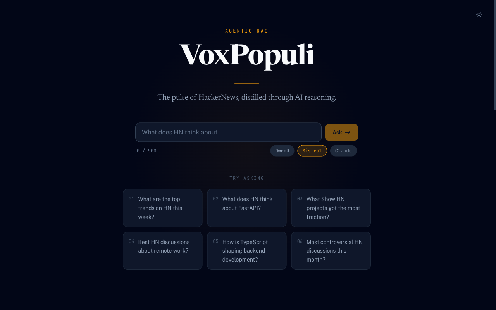
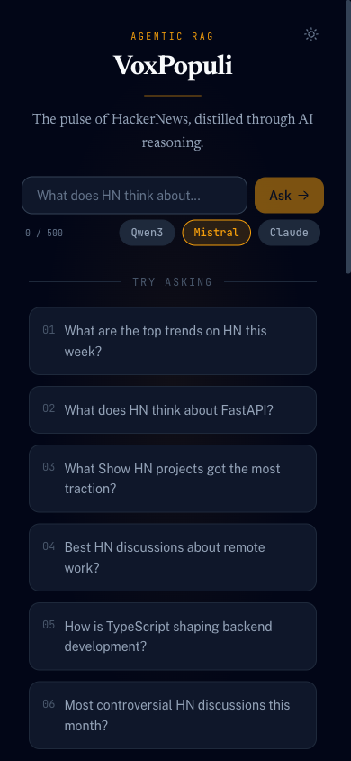
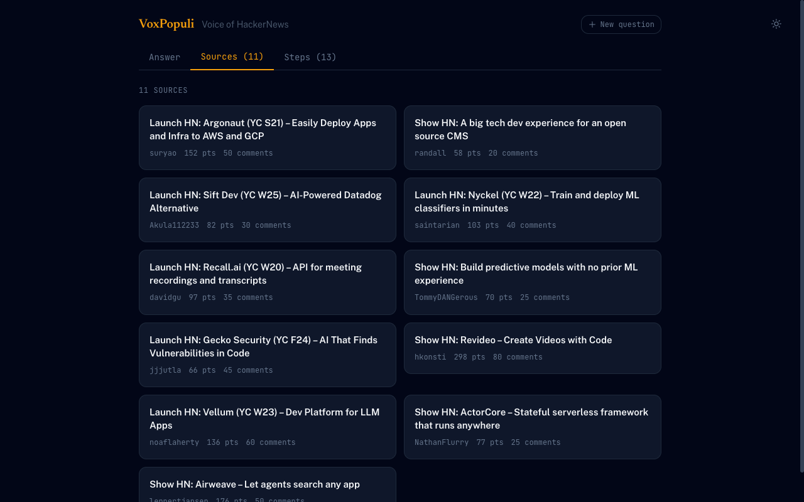
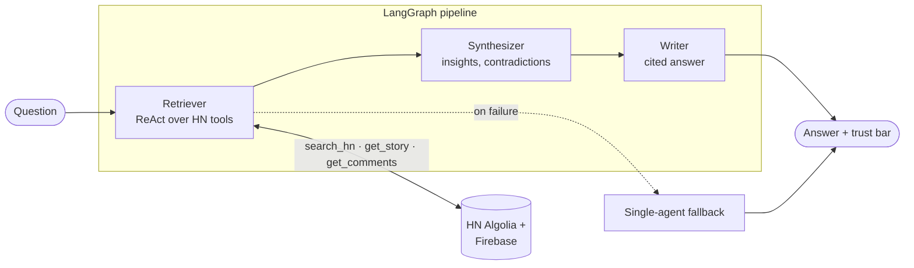

<p align="center">
  <a href="https://voxpopuli-web-embx.onrender.com/">
    
  </a>
</p>

<p align="center">
  <a href="https://voxpopuli-web-embx.onrender.com/"><b>Try it live</b></a>
  &nbsp;&middot;&nbsp;
  <a href="docs/architecture.md">Architecture</a>
  &nbsp;&middot;&nbsp;
  <a href="docs/product.md">Product</a>
  &nbsp;&middot;&nbsp;
  <a href="evals/README.md">Evals</a>
  &nbsp;&middot;&nbsp;
  <a href="#decisions-and-trade-offs">Decisions</a>
</p>

<p align="center">
  <a href="https://github.com/darth-dodo/voxpopuli/actions/workflows/ci.yml"></a>
  <a href="https://github.com/darth-dodo/voxpopuli/releases/latest"></a>
  <a href="https://codecov.io/gh/darth-dodo/voxpopuli"></a>
  <a href="https://voxpopuli-web-embx.onrender.com/"></a>
  <a href="LICENSE"></a>
</p>

The best engineering opinions on Hacker News sit three levels deep in 400 comment threads, and Algolia only matches keywords. I built VoxPopuli to ask a question in plain English and get back what HN actually thinks, with every claim linked to its thread, a note on how strong the evidence is, and a narrated version if you would rather listen.

<p align="center">
  
  &nbsp;
  
  &nbsp;
  
</p>

## How it works



The Retriever searches HN, reads up to 30 comments per story and compacts them into themes. The Synthesizer weighs them, and the Writer streams a cited answer as a live draft. Every step reaches the browser over SSE, and a trust bar reports verified sources, recency and viewpoint balance; fewer than three sources caps the confidence and says what is missing. Mistral, Claude and Qwen3 (via OpenRouter) are switchable per question, and Listen mode narrates the answer with Mistral Voxtral.

**How we know it works:** 736 unit tests (472 API, 251 web, 13 shared types), with every HN and LLM call mocked, run in CI on each pull request. Unit tests cannot judge an answer, so `pnpm eval` runs 28 benchmark questions through the live pipeline and scores sources, quality (LLM judge), efficiency, latency and cost. That harness measured the latency numbers below.

## Decisions and trade-offs

| Decision                                                                                                 | Why                                                                                                                                    | Cost, or when to revisit                                                                                                                       |
| -------------------------------------------------------------------------------------------------------- | -------------------------------------------------------------------------------------------------------------------------------------- | ---------------------------------------------------------------------------------------------------------------------------------------------- |
| Models write only judgement; code attaches source metadata ([ADR-009](docs/adr/009-pipeline-latency.md)) | Output tokens dominated latency, and models were retyping titles and dates. Mean fell from 43.7 s to 23.9 s, p95 from 68.9 s to 30.4 s | Source facts must come from the tools' registry, never from an LLM output schema                                                               |
| Three-stage pipeline with a single-agent fallback ([architecture](docs/architecture.md))                 | Each stage has one job and its own prompt and tests; the fallback keeps stages that already finished                                   | Three LLM calls per answer; the opt-in merged writer drops one for a 27% lower mean ([ADR-010](docs/adr/010-merged-writer-and-model-speed.md)) |
| HN text wrapped in `<hn_content>` and never obeyed                                                       | Anyone can post "ignore previous instructions" in a comment                                                                            | Delimiters reduce prompt injection risk, they do not remove it                                                                                 |
| Query IDs with results stored on the server ([ADR-007](docs/adr/007-query-id-resilience.md))             | Phones drop background connections; a returning tab fetches or reattaches instead of paying twice                                      | Results live in process memory, so a restart loses runs in flight                                                                              |
| Three providers behind one LangChain facade ([ADR-003](docs/adr/003-llm-provider-architecture.md))       | No single model wins on cost, quality and synthesis at once                                                                            | Provider quirks (JSON mode, retries) live in each provider class                                                                               |
| Mistral Voxtral for narration ([ADR-008](docs/adr/008-voxtral-tts.md))                                   | Same account and key as the default LLM, so no second vendor                                                                           | Not streamed: playback waits for the whole clip, about 10 s at the cap                                                                         |
| One `AsyncGenerator` for SSE and blocking answers ([ADR-005](docs/adr/005-true-sse-streaming.md))        | Both endpoints consume the same events, so they cannot drift                                                                           | The API must be a long-running process, not serverless                                                                                         |

## Run it locally

```bash
git clone https://github.com/darth-dodo/voxpopuli.git && cd voxpopuli
pnpm install
cp .env.example .env        # MISTRAL_API_KEY is enough, it also powers Listen mode
pnpm exec nx serve api      # http://localhost:3000/api
pnpm exec nx serve web      # http://localhost:4200
```

Needs Node.js 22 and pnpm 10. Every setting is listed in [`.env.example`](.env.example).

| Command                                                    | Does                                                                     |
| ---------------------------------------------------------- | ------------------------------------------------------------------------ |
| `pnpm exec nx run-many -t test lint build`                 | what CI runs, plus `pnpm exec prettier --check .`                        |
| `pnpm eval`                                                | the 28 eval questions against a running API ([options](evals/README.md)) |
| `pnpm exec tsx evals/run-eval.ts --baseline <report.json>` | latency A/B against a saved run                                          |
| `pnpm eval:compare`                                        | the same questions across all three providers                            |

Deployment is a [Render Blueprint](render.yaml): a Docker API service and a static web site, sharing the `voxpopuli-secrets` env group.

## Built with

<p>
  
  
  
  
  
  
  
  
  
  
</p>

## Docs

| Doc                                          | For                                                  |
| -------------------------------------------- | ---------------------------------------------------- |
| [Product](docs/product.md)                   | features, API contracts, roadmap                     |
| [Architecture](docs/architecture.md)         | modules, pipeline, milestones                        |
| [Codebase summary](docs/codebase-summary.md) | module inventory and environment reference           |
| [Design system](docs/design-system.md)       | "Data Noir Editorial"                                |
| [ADRs](docs/adr/)                            | settled decisions, 001 to 010                        |
| [Evals](evals/README.md)                     | the harness and every CLI option                     |
| [CLAUDE.md](CLAUDE.md)                       | conventions and pitfalls for agents and contributors |
| [Changelog](CHANGELOG.md)                    | what shipped, by version                             |

To contribute, branch from `main`, use [Conventional Commits](https://www.conventionalcommits.org), mock external calls in tests and add an ADR for design decisions. Licensed [MIT](LICENSE).
